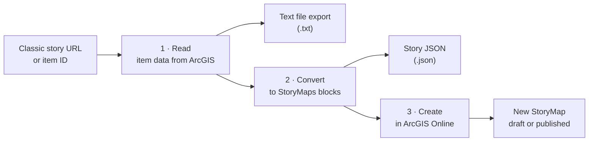

<div align="center">


# StoryMap Converter

**Bring retired classic Esri Story Maps back to life as modern ArcGIS StoryMaps.**


*Designed by [Tom Baker](https://tbaker.com)*

</div>

---

## Why it exists

Esri has retired the classic Story Map templates. Open an old Map Series or Map Journal link today and you get an **Item Replacement** notice instead of the story.

The story itself isn't gone. Its titles, text, images, maps and videos are still stored in the item's data on ArcGIS Online. StoryMap Converter reads that data and rebuilds the story as a new ArcGIS StoryMap in your own account, in a few clicks and without retyping anything.

## How it works



| Step | What happens |
|:--:|---|
| **1 · Read** | Paste a classic story link. The app finds the item, identifies the template, lists every entry, and lets you download everything as a text file: plain text, original HTML, every text field, and the raw JSON. |
| **2 · Convert** | Pick a layout. **Sidecar with a docked panel** is the closest match to the classic side panel. **Scrolling sections** puts entries one after another. An outline previews the new story before anything is created. |
| **3 · Create** | Sign in with your ArcGIS Online username and password, then publish straight away (the default) or save a private draft. You get links to the builder, the live story and its item page. |

## What carries over

| From the classic story | Becomes in ArcGIS StoryMaps |
|---|---|
| Story title and summary | Story cover. The first image found becomes a full-bleed cover. |
| Each entry or section | A sidecar slide, or a heading and section |
| Entry image | Image block, copied into the new story when the host allows it |
| Entry web map | Web map block, keeping that entry's map extent and which layers were on |
| Embedded web page | Embed card |
| YouTube or Vimeo video | Inline video player. Links point to the normal watch page. |
| Bold, italics, links, headings, lists, quotes | Native StoryMaps text styles |
| Fonts, colours, sizes from the old template | Dropped, so the new story's theme styles the text |
| Item tags, summary, description, credits | Copied to the new item |

**Templates recognised:** Map Series, Map Journal, Cascade, Shortlist, Swipe and Spyglass, Map Tour, Crowdsource, Basic, Countdown and Playlist. Map Series, Map Journal, Cascade and Shortlist convert entry by entry, section by section or tab by tab. For the others, the text-file export still captures every piece of text in the story, so nothing is lost.

## Getting started

1. Keep all the files together in one folder.
2. Open **`index.html`** in Chrome, Edge, Firefox or Safari. Double-clicking it works.
3. The example story loads straight away. Paste your own classic story link to convert it.

If an organization restricts which websites may read its content, requests from a desktop file can be refused. Serve the folder from a simple local web server instead:

```bash
python -m http.server 8000
# then open http://localhost:8000/
```

Or put the folder on any web host, which is also where Google Analytics starts counting visits.

## Files

| File | Purpose |
|---|---|
| `index.html` | The page: layout, icon, and links to the files below |
| `styles.css` | All styling, with light and dark themes |
| `reader.js` | Step 1: reads the classic story and builds the text-file export |
| `converter.js` | Steps 2 and 3: conversion, sign-in, creating, publishing and deleting |
| `analytics.js` | Google Analytics configuration |
| `logo.svg` | The app icon, for this README |

## Privacy and security

- **Your password goes only to ArcGIS Online**, which swaps it for a sign-in token. The token lives in the page's memory and is gone when you close the tab. Nothing is saved to disk.
- The app talks only to ArcGIS Online, StoryMaps, the image hosts the classic story uses, Google Fonts and Google Analytics. There is no other server behind it.

## Good to know

- **Single sign-on accounts can't sign in here.** The form needs an ArcGIS login with a username and password. Accounts that sign in through an organization's SAML or OpenID login won't work.
- **You need permission to create content** (a Creator role or equivalent). The app warns you if your account lacks it.
- **Publishing from the app skips the builder's issue checker.** Open the new story in the builder once to review it.
- **Map Tour points and Shortlist places** live in a separate feature layer, not in the story data. The app converts Shortlist tab titles and descriptions and lists the Map Tour order, but doesn't rebuild the tour or the places map.
- **Images on old hosts** such as legacy Flickr addresses are copied into the new story when the host allows it. Otherwise they stay linked, and the log says how many.
- **Delete this story** appears after each run, which makes test conversions easy to clean up.

<div align="center">

---

Made for everyone with a shelf of classic Story Maps worth keeping.
<br>
<sub>ArcGIS, ArcGIS Online and ArcGIS StoryMaps are trademarks of Esri. This project is not affiliated with Esri.</sub>

</div>
