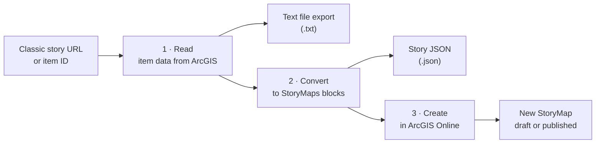

<div align="center">


# Classic StoryMap Extractor

**Bring retired classic Esri Story Maps back to life as modern ArcGIS StoryMaps, from ArcGIS Online or self-hosted on any website.**


*Designed by [Tom Baker](https://tbaker.com)*

</div>

---

## Why it exists

Esri has retired the classic Story Map templates. Open an old Map Series or Map Journal link today and you get an **Item Replacement** notice instead of the story.

The story itself isn't gone. Its titles, text, images, maps and videos are still stored in the item's data on ArcGIS Online. Classic StoryMap Extractor reads that data and rebuilds the story as a new ArcGIS StoryMap in your own account, in a few clicks and without retyping anything.

## How it works



| Step | What happens |
|:--:|---|
| **1 · Read** | Paste a classic story link, an item ID, or the address of a self-hosted story on any website. The app finds the story, identifies the template, lists every entry, and lets you download everything as a text file: plain text, original HTML, every text field, and the raw JSON. |
| **2 · Convert** | Pick a layout. **Scrolling sections** (the default) gives each entry a heading, then its image or live map, then its text. **Sidecar with a docked panel** makes each entry a slide with its text beside its image or map, closest to the classic side panel. An outline previews the new story before anything is created. |
| **3 · Create** | Sign in with your ArcGIS Online username and password, and the story is saved as a private draft. Review it in the builder and publish from there. You get links to the builder and the item page. |

## What carries over

| From the classic story | Becomes in ArcGIS StoryMaps |
|---|---|
| Story title and summary | Story cover. The first image found becomes a full-bleed cover. |
| The classic story's author | The cover byline: the story owner's full name from their public profile, or their username when the profile is private. Self-hosted stories use the owner of their web maps. It's filled in under **Byline**, where you can change it |
| Each entry or section | A heading and section, or a sidecar slide |
| Entry image | Image block, copied into the new story when the host allows it |
| Entry web map | Web map block, keeping that entry's map extent and which layers were on |
| The story's main map, when no entry shows it | A live map as the first section or slide |
| Embedded map viewer or map app (Map Viewer, embed viewer, Instant or classic app) | A live map block of the web map it shows, keeping any extent in its link |
| Classic Swipe or Spyglass of two web maps | A StoryMaps swipe of the same two live maps, both sides at the same view |
| Classic Swipe of layers in one web map | A swipe of that live map, with the swiped layers on the left and hidden on the right |
| Swipe series bookmarks | One section per bookmark: its name, its text, and the swipe zoomed to it |
| Classic Map Tour places (from the tour's point layer, stored in the web map or a hosted layer) | A guided tour: numbered places in the classic order, each with its name, text and photo or video. Hidden places are left out, and a first record used as an intro opens the story before the tour |
| The Map Tour's web map | The tour map's basemap: a copy made in your account without the tour's point layer, so the places aren't drawn twice (updated too if it's an old web map) |
| Classic Shortlist tabs and places | One guided tour per tab, in the tab's colour, with each place's name, text and photo. Places without a tab come last |
| Classic Crowdsource contributions | A guided tour of the approved, visible contributions with their photos. Rejected and hidden ones, and contributor names, are left out |
| Cascade cover, sequences, title sections, immersive sections and credits | The story cover, narrative blocks (galleries, maps, scenes and videos too), headings, a floating-panel sidecar with one slide per immersive view, and a credits list |
| Map Journal and Map Series text links that zoomed the map or showed other media | In the sidecar layout, map actions on the slide's map, or buttons that swap the slide's media. In the scrolling layout, the linked view or media follows the section |
| Web maps made only of sketched notes (Map Notes) | An express map: each point, line, area and text label becomes an editable drawing, with its title, text and photo link, over a copy of the web map without the notes |
| Old web maps (spec 1.x, untyped layers, http:// layers or a Bing basemap, roughly 2012 to 2014) | An updated copy in your account that uses the same data layers, upgraded to the current web map format, and used in the story in place of the original. Bing basemaps become the matching Esri basemaps |
| Other embedded web page | Embed card |
| YouTube or Vimeo video | Inline video player. Links point to the normal watch page. |
| Bold, italics, links, headings, lists, quotes | Native StoryMaps text styles |
| Fonts, colours, sizes from the old template | Dropped, so the new story's theme styles the text |
| Item tags, summary, description, credits | Copied to the new item |

Maps are never copied or turned into pictures. Every map block shows the original live web map.

**Templates recognised:** Map Series, Map Journal, Cascade, Shortlist, Swipe and Spyglass, Map Tour, Crowdsource, Basic, Countdown and Playlist. Map Series and Map Journal convert entry by entry, and Cascade section by section. Swipe and Spyglass become swipe blocks. Map Tour, Shortlist and Crowdsource become guided tours. Basic opens with its live map, and with its legend when the classic story showed one. For Countdown and Playlist, the text-file export still captures every piece of text in the story, so nothing is lost.

Only what readers could see is converted: hidden Map Series entries, draft Map Journal sections and hidden tour places are left out.

## Self-hosted classic stories

In the early years of classic Story Maps, Esri let authors download a template and host it on their own website, at any address. For example:

```
https://storymaps.esri.com/stories/2014/womeningis/
```

Paste a link like that and the app does the following:

1. Reads the page and finds the story's settings (the template's `configOptions`), either in the page itself or in the config script the page loads, such as `app/series/Config.js`.
2. Reads those settings as data. It never runs the website's code.
3. Builds the story from what the settings point to:
   - **A story item (`appid`):** converts that ArcGIS item as normal.
   - **A list of web maps (`webmap` or `webmaps`):** turns each map into an entry. Its title comes from the settings or the web map's title, and its text from the web map's description, just as the classic template showed it.
   - **Neither:** uses the page's own visible text as a single entry.

The story's title and subtitle come from the settings too. A subtitle with links also becomes the opening paragraph, so the links aren't lost.

**When a website blocks reading.** Some websites don't let other pages read their files, and the app says so when that happens. Open the story in your browser, save it (Ctrl+S, "Webpage, Complete"), and load the saved page plus its config script under **Self-hosted story on a website that blocks reading**.

## Maps and map data

Maps are rebuilt, never pictured, and their data is always pointed to rather than copied. Feature, map, image and vector tile services stay where they are, and every map block opens the live layers.

| The classic map | Is rebuilt as |
|---|---|
| A current web map | The same web map, opened at the classic entry's view with the classic layer visibility |
| An old web map (1.x format, untyped or `http://` layers, a Bing basemap) | An updated copy of the web map in your account, as described below |
| A web map made only of sketched notes (Map Notes points, lines, areas and text) | An **express map**. Its drawings, popups and groups are written to the story's `expressmap_<ms>.json` file, the same format the StoryMaps builder saves. Its basemap is a copy of the classic web map without the notes |
| A web map that's deleted or no longer shared | A placeholder image saying the map is unavailable, in the same spot. The classic story saved only the map's ID and views, never its data. Untick **Replace maps that can't be read** to keep linking the original instead |
| A tour's or Shortlist's web map | The guided tour's map: a copy without the places layer, so places aren't drawn twice |

Imported data (CSV, shapefile or GPX layers stored in the map), maps with service layers, multi-part shapes, and maps with more than 200 notes stay traditional web maps, which keep their fields, popups and styles. Untick **Rebuild maps made only of sketched notes as express maps** to keep every map as a web map.

## Old web maps and sharing

Many classic stories use web maps saved in the old web map format, version 1.x. Their layers have no type, they use `http://` addresses that an `https` story blocks, and they have no starting view. When **Make updated copies of old web maps in your account** is ticked, which is the default, creating the story also:

1. Makes a new web map in your account for each old one. It references exactly the same data layers and basemap, with layer types filled in, `https` addresses where the service supports them, a spatial reference, a starting view and updated bookmarks. Its description links back to the original.
2. Uses the new maps in the story in place of the originals. The original maps are never changed.
3. Notes any layer whose service no longer responds. The layer stays in the map, but it won't draw.

**Share the story and its maps with** sets one level, Only me, My organization or Everyone, for:
- the story
- the updated maps
- any other map in the story that you own (only ever shared more widely, never less)

Maps owned by someone else can't be changed. If one is shared more narrowly than the story, the log says so.

**Delete this story** also deletes the updated maps made for it.

## Getting started

1. Keep all the files together in one folder.
2. Open **`index.html`** in Chrome, Edge, Firefox or Safari. Double-clicking it works.
3. Paste a classic story link, item ID or self-hosted story address, and choose **Read story**.

If an organization restricts which websites may read its content, requests from a desktop file can be refused. Serve the folder from a simple local web server instead:

```bash
python -m http.server 8000
# then open http://localhost:8000/
```

Or put the folder on any web host, which is also where Google Analytics starts counting visits.

## Files

| File | Purpose |
|---|---|
| `index.html` | The page: layout, icon, and links to the files below |
| `styles.css` | All styling, with light and dark themes |
| `reader.js` | Step 1: reads the classic story, from ArcGIS or a self-hosted website, and builds the text-file export |
| `converter.js` | Steps 2 and 3: conversion, sign-in, creating, publishing and deleting |
| `analytics.js` | Google Analytics configuration |
| `logo.svg` | The app icon, for this README |

## Privacy and security

- **Your password goes only to ArcGIS Online**, which swaps it for a sign-in token. The token lives in the page's memory and is gone when you close the tab. Nothing is saved to disk.
- The app talks only to ArcGIS Online, StoryMaps, the website of a self-hosted story you paste, the image hosts the classic story uses, Google Fonts and Google Analytics. There is no other server behind it.
- A self-hosted story's settings are read as plain data. None of that website's code runs inside the app.

## Good to know

- **Single sign-on accounts can't sign in here.** The form needs an ArcGIS login with a username and password. Accounts that sign in through an organization's SAML or OpenID login won't work.
- **You need permission to create content** (a Creator role or equivalent). The app warns you if your account lacks it.
- **Stories are always saved as drafts.** Publishing straight from the app is turned off, so every story goes through the builder's issue checker when you publish it there.
- **Shortlist, Map Tour and Crowdsource places** are read from their point layers, so those layers must still be shared publicly (or with your sign-in) for the places to come across.
- **Crowdsource stories** become read-only tours of their approved contributions; collecting new ones needs a form app such as ArcGIS Survey123.
- **Audio** in Cascade stories has to be uploaded again in the builder.
- **Images on old hosts** such as legacy Flickr addresses are copied into the new story when the host allows it. Otherwise they stay linked, and the log says how many.
- **Delete this story** appears after each run, which makes test conversions easy to clean up.

<div align="center">

---

Made for everyone with a shelf of classic Story Maps worth keeping.
<br>
<sub>ArcGIS, ArcGIS Online and ArcGIS StoryMaps are trademarks of Esri. This project is not affiliated with Esri.</sub>

</div>
